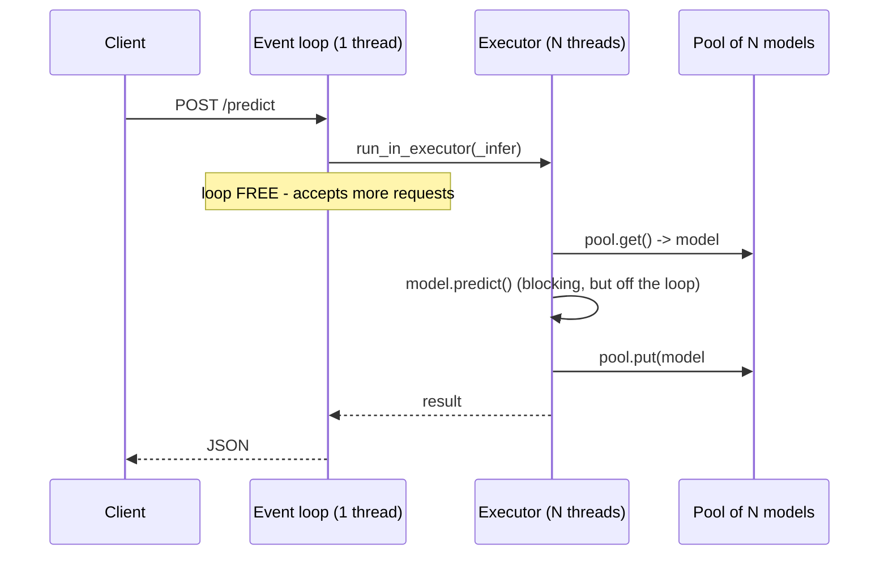
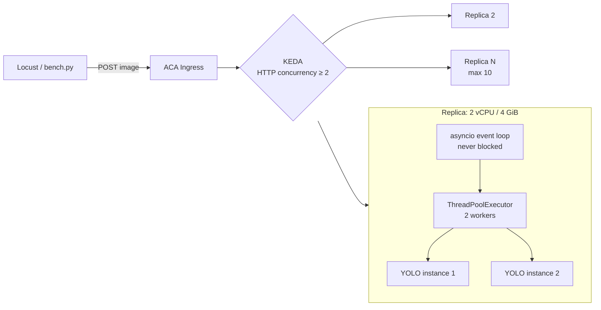

# AI Models on Azure Container Apps — Scaling & Load-Test Demo

Two self-contained demos that wrap an **OSS model in FastAPI**, containerize it, deploy to
**Azure Container Apps (ACA)**, and drive it with a load test to showcase **autoscaling**.

| Demo | Task | Model (OSS) | Endpoint |
|------|------|-------------|----------|
| [`yolo-demo/`](yolo-demo/) | Object detection | Ultralytics **YOLO** (`yolov8n`) | `POST /predict` |
| [`ocr-demo/`](ocr-demo/)   | OCR (read text)  | **EasyOCR** | `POST /ocr` |

Both apps expose the same operational surface so the demo story is identical:

| Route | Purpose |
|-------|---------|
| `GET /` | Service info + effective concurrency config |
| `GET /healthz` | Liveness/readiness probe (used by ACA) |
| `GET /stats` | Live concurrency + memory counters — **use this to prove parallelism** |
| `POST /predict` or `/ocr` | Inference (`multipart/form-data`, field `file`) |

> **Note:** YOLO does *object detection* (boxes around objects). EasyOCR does *OCR* (reads text).
> For a scaling/load-test demo the task doesn't matter — pick whichever your team lands on, or demo both.

> 📊 **Presenting this?** Open [`presentation.html`](presentation.html) — an 18-slide interactive
> walkthrough of the same material, built to be projected. Arrow keys navigate, `O` for slide
> overview, `T` toggles light/dark, `F` fullscreen. Self-contained, no build step, no network.

---

## TL;DR — the code that makes YOLO run several inferences at once

This is the section to put on screen. Four pieces, all in
[yolo-demo/app/main.py](yolo-demo/app/main.py) (the OCR demo is identical bar the model class).

**1 — At startup, build N models and an N-thread executor** — [main.py](yolo-demo/app/main.py#L97-L114)

```python
torch.set_num_threads(TORCH_THREADS_PER_WORKER)      # cap BEFORE building models

pool = queue.Queue()
for _ in range(INFERENCE_WORKERS):
    model = YOLO(MODEL_NAME)
    model.predict(warm, imgsz=IMGSZ, conf=CONF, verbose=False)   # warm THIS instance
    pool.put(model)

state["pool"]     = pool
state["executor"] = ThreadPoolExecutor(max_workers=INFERENCE_WORKERS)
```

**2 — The endpoint hands work to a thread and never blocks** — [main.py](yolo-demo/app/main.py#L186-L192)

```python
raw   = await file.read()                       # async I/O: fine on the event loop
image = Image.open(io.BytesIO(raw)).convert("RGB")

loop   = asyncio.get_running_loop()
result = await loop.run_in_executor(state["executor"], _infer, image)
```

**3 — Each worker borrows its *own* model, then returns it** — [main.py](yolo-demo/app/main.py#L131-L141)

```python
def _infer(image):
    model = state["pool"].get()      # borrow: no two threads share an instance
    try:
        return model.predict(image, imgsz=IMGSZ, conf=CONF, verbose=False)
    finally:
        state["pool"].put(model)     # ALWAYS returned, even if predict() raised
```

**4 — ACA adds replicas when a replica would have to queue** — [deploy/deploy.ps1](deploy/deploy.ps1)

```powershell
--scale-rule-type http --scale-rule-http-concurrency $InferenceWorkers `
--min-replicas 0 --max-replicas 10
```

The whole trick is one invariant: **executor threads == pool size**. At most N threads can be
inside `_infer`, and there are exactly N models, so `pool.get()` never waits and no two threads
can ever touch the same model.



**Verified live** — same load (24 images, concurrency 8, 1 replica), only `INFERENCE_WORKERS` changed:

| `INFERENCE_WORKERS` | `peak_in_flight` | `peak_running` | Correct | p50 @ conc 8 |
|---:|---:|---:|---:|---:|
| 1 | 8 | **1** | 24/24 | 1326 ms |
| 2 | 8 | **2** | 24/24 | **229 ms** |

Full reasoning for *why* each piece is needed is in
[The concurrency problem](#the-concurrency-problem-the-most-valuable-part-of-this-demo) below.

---

## The concurrency problem (the most valuable part of this demo)

> *"We saw YOLO handle only 1 image at a time — it couldn't run several inferences in parallel."*

This is a real and extremely common failure. It is **not** a limitation of YOLO itself —
it's caused by two independent bugs that almost every naive FastAPI wrapper has. Both are
fixed in this repo, and both are worth showing on screen.

### Cause 1 — Blocking the asyncio event loop

The naive wrapper looks like this, and it is what most teams write first:

```python
@app.post("/predict")
async def predict(file: UploadFile = File(...)):
    ...
    results = model.predict(image)   # <-- blocking, CPU-bound, ~100 ms
    return results
```

`async def` runs the handler **on the event loop thread**. `model.predict()` is a blocking
C/C++ call that never yields. While it runs, the single event loop thread cannot accept a new
connection, parse a request, or answer anything else — **not even `/healthz`**.

Result: the process serves **exactly one request at a time**, regardless of how many CPU cores
the container has. Throughput is pinned at `1 / latency`, and health probes time out under
load, which can make ACA restart otherwise-healthy replicas.

**Fix:** never run blocking inference inside `async def`. Offload it to a thread pool so the
event loop stays free.

```python
loop = asyncio.get_running_loop()
result = await loop.run_in_executor(state["executor"], _infer, image)
```

> FastAPI does this automatically if you declare the handler as plain `def` instead of
> `async def` — but then you get FastAPI's shared 40-thread pool, which runs straight into
> Cause 2. An explicit, bounded executor is the correct fix.

### Cause 2 — Ultralytics `YOLO` objects are not thread-safe

Even after unblocking the event loop, you cannot simply let N threads call the *same* model:

```python
model = YOLO("yolov8n.pt")   # ONE shared instance

def _infer(image):
    return model.predict(image)   # <-- data race across threads
```

A `YOLO` instance lazily creates and **reuses a `model.predictor`** object that holds mutable
per-call state (the current batch, source, and results buffers). Two threads entering
`predict()` concurrently overwrite each other's buffers — you get corrupted or
cross-contaminated detections, and intermittent crashes. The same applies to `easyocr.Reader`.

**Fix:** give every worker thread its **own model instance**, borrowed from a pool:

```python
pool = queue.Queue()
for _ in range(INFERENCE_WORKERS):
    pool.put(YOLO(MODEL_NAME))          # one instance per worker

def _infer(image):
    model = pool.get()                  # borrow — never shared
    try:
        return model.predict(image, verbose=False)
    finally:
        pool.put(model)                 # always return it
```

Because the executor has exactly `INFERENCE_WORKERS` threads and the pool holds exactly
`INFERENCE_WORKERS` models, `pool.get()` never blocks — every running thread is guaranteed
its own model.

### Cause 3 (the subtle one) — CPU oversubscription

PyTorch is already internally multi-threaded: one `predict()` call will by default spread its
matrix maths across *every* core it can see. If you then run 4 workers on a 2-core container,
you get 4 × N threads fighting for 2 cores — context-switch thrashing makes **every** request
slower while total throughput barely moves.

**Fix:** cap intra-op threads per worker and keep `workers × threads ≤ container vCPU`.

```python
torch.set_num_threads(TORCH_THREADS_PER_WORKER)   # default 1
```

> **Gotcha:** `os.cpu_count()` inside a container reports the **host's** core count, not the
> ACA CPU limit. Never auto-size your pool from it — [deploy/deploy.ps1](deploy/deploy.ps1)
> passes `INFERENCE_WORKERS` explicitly as an env var.

### Before / after

| | Naive wrapper | This repo |
|---|---|---|
| Handler | `async def` + blocking call | `async def` + `run_in_executor` |
| Model instances | 1, shared | `INFERENCE_WORKERS`, pooled |
| Torch threads | unbounded (host core count) | `TORCH_THREADS_PER_WORKER` (1) |
| Parallel inferences / replica | **1** | **`INFERENCE_WORKERS`** |
| `/healthz` under load | times out | always answers |
| Correctness under load | races, mixed-up results | isolated per thread |

### Proving it during the demo

`/stats` reports the server's own view of concurrency. Two distinct counters, and the
difference between them *is* the lesson:

| Field | Meaning |
|---|---|
| `in_flight` / `peak_in_flight` | Requests accepted — **queued OR executing** |
| `running` / `peak_running` | Requests actually inside `model.predict()` — **true parallelism** |

`peak_running` can never exceed the pool size, which makes the fix undeniable. **These are real
responses from the deployed app**, same load in both cases (concurrency 8, 24 images, 1 replica):

```jsonc
// INFERENCE_WORKERS=1 -> 8 requests accepted, but only ever ONE executing
{ "inference_workers": 1, "peak_in_flight": 8, "peak_running": 1,
  "rss_mb": 463.8, "rss_baseline_mb": 425.8 }

// INFERENCE_WORKERS=2 -> same queue depth, TWO executing in parallel
{ "inference_workers": 2, "peak_in_flight": 8, "peak_running": 2,
  "rss_mb": 495.6, "rss_baseline_mb": 427.4 }
```

A large gap between `peak_in_flight` and `peak_running` means requests are **queueing** — the
replica is saturated and ACA should scale out. `rss_mb` vs `rss_baseline_mb` separates the fixed
cost (runtime + pooled weights) from per-inference activation memory.

Each inference response also carries a breakdown so you can show *where* time goes:

```jsonc
{
  "inference_ms": 154.9,   // real model time
  "total_ms":     155.6,   // as seen by the client
  "queue_wait_ms": 0.7,    // time waiting for a free worker -> the signal to scale out
  "replica": "yolo-demo--vq19mkk-6b97947c6d-fg5hk"
}
```

**`queue_wait_ms` is the money metric.** When it rises while `inference_ms` stays flat, the
replica is saturated and it is time for ACA to add another one.

### Is the output actually correct now?

Yes — and this is the half of the bug that matters most. The naive version doesn't crash, it
**silently returns wrong results**: image A's detections come back for image B. Nothing appears
in the logs; you only find out in production.

The pool makes that structurally impossible:

```python
model = pool.get()          # this thread now OWNS this instance
try:
    return model.predict(image, verbose=False)
finally:
    pool.put(model)         # returned only after the call completes
```

The executor has exactly N threads and the pool holds exactly N models, so **no two threads can
ever hold the same instance**. Isolation is guaranteed by construction, not by timing luck. The
`finally` guarantees an instance is never lost from the pool even if inference raises.

---

## Does this apply to other OSS models?

Almost always yes. The two failure modes generalise, but the *reason* differs per library:

| Model / library | Blocking event loop? | Instance thread-safe? | Recommended parallelism |
|---|---|---|---|
| **Ultralytics YOLO** | Yes — always offload | **No** — reuses `model.predictor` state | Pool of `YOLO` instances |
| **EasyOCR** | Yes | **No** — `Reader` holds per-call state | Pool of `Reader` instances |
| **PaddleOCR** | Yes | **No** — `PaddleOCR` object is stateful | Pool of `PaddleOCR` instances |
| **Tesseract** (`pytesseract`) | Yes | Effectively yes — forks a subprocess per call | Thread pool, no model pool needed |
| **docTR** | Yes | Predictor is stateful | Pool of predictors |
| **Raw `torch.nn.Module`** | Yes | **Yes** for pure `forward()` under `no_grad()` | Share one model, just cap threads |
| **ONNX Runtime** | Yes | **Yes** — `InferenceSession.run()` is thread-safe | Share one session; tune `intra_op_num_threads` |

The rules of thumb:

1. **Every** CPU-bound inference call must be moved off the asyncio event loop. This is universal —
   it has nothing to do with the model, only with how FastAPI/asyncio works.
2. **High-level convenience wrappers are usually NOT thread-safe.** Anything that hides a
   "predictor"/"session"/"pipeline" object and mutates it per call (YOLO, EasyOCR, PaddleOCR,
   HuggingFace `pipeline`) needs one instance per worker.
3. **Low-level inference engines usually ARE thread-safe.** A bare PyTorch `forward()` under
   `torch.no_grad()`, or an ONNX Runtime session, can be shared — there you scale by tuning
   intra-op threads instead of duplicating the model.
4. **When in doubt, pool it.** The cost is memory (`N × model size`); the benefit is correctness.
   `yolov8n` is ~6 MB, so a pool of 2–4 is free. A 2 GB LLM is a different conversation — there
   you share the model and scale out with replicas instead.

Porting either demo to another model means changing only two things: the factory call inside
`lifespan` that fills the pool, and the body of `_infer`. The executor, counters, pooling and
ACA wiring stay identical.

> **Special case — GPU models.** Pooling does *not* help on a single GPU: the device serialises
> kernels anyway and N model copies just consume N× VRAM. There, use batching (collect requests
> for a few ms, run one batched forward) or a purpose-built server such as Triton / vLLM, and
> scale out with GPU-enabled ACA workload profiles.

---

## Two ways to scale — and why we do both

| Axis | Mechanism | Good for | Limit |
|------|-----------|----------|-------|
| **Scale up** (in-replica) | model pool, `INFERENCE_WORKERS` | using the CPU you already pay for | bounded by replica vCPU |
| **Scale out** (replicas) | ACA + KEDA HTTP concurrency rule | unbounded throughput, resilience | cold-start latency |

### Aligning the pool with the ACA scale rule

The two axes must agree, or one of them silently wins. The rule is simply:

$$\text{scale-rule concurrency} = \texttt{INFERENCE\_WORKERS}$$

which is why [deploy/deploy.ps1](deploy/deploy.ps1) defaults `-ConcurrentRequests` to
`-InferenceWorkers`.

| Configuration | What happens |
|---|---|
| Rule **>** workers (rule 10, workers 2) | Replica accepts 10 concurrent but runs 2. The other 8 pile into `queue_wait_ms`; latency balloons and **ACA never scales out** because the replica looks like it's coping. |
| Rule **<** workers (rule 1, workers 2) | ACA adds replicas while each existing one is only half busy. You pay for idle CPU. |
| Rule **=** workers | A replica takes exactly what it can genuinely run in parallel; the moment it would queue, KEDA adds a replica. |

Total capacity:

$$\text{max concurrent inferences} = \texttt{INFERENCE\_WORKERS} \times \text{maxReplicas}$$

With the defaults (2 workers × 10 replicas) the app tops out at **20 concurrent inferences**.

### The "one replica per inference" option

Doing *only* scale-out with `INFERENCE_WORKERS=1` is a legitimate design and the simplest
possible mental model — it sidesteps in-process threading entirely:

```powershell
./deploy.ps1 -Demo yolo -InferenceWorkers 1 -Cpu 1.0 -Memory 2.0Gi -ConcurrentRequests 1
```

Trade-off: scaling becomes purely horizontal, so you pay more cold starts and reload the model
in every replica. The 2-workers-per-replica default gets roughly double the throughput out of
CPU you are already paying for.

---

## Performance & scaling numbers

**All numbers below are real**, measured against `yolo-demo` on ACA in `swedencentral`,
`yolov8n` @ 640px, 640×480 JPEG input, replicas sized **2 vCPU / 4 GiB**. The client ran from a
laptop over the public internet, so latency includes real network round-trip.

### A. Correctness under concurrency — [loadtest/correctness.py](loadtest/correctness.py)

The test that actually matters. Each image carries a unique, verifiable marker (an ellipse at an
X position unique to that image), all sent concurrently, then every response is checked against
**the image that produced it**. A shared-model bug would return image A's boxes for image B.

| Scenario | Images | Concurrency | Correct | Wrong | Errors | `peak_running` |
|---|---:|---:|---:|---:|---:|---:|
| 1 replica, `workers=1` | 24 | 8 | **24/24** | 0 | 0 | 1 |
| 1 replica, `workers=2` | 24 | 8 | **24/24** | 0 | 0 | 2 |
| 10 replicas, `workers=2` | 60 | 20 | **60/60** | 0 | 0 | 2 per replica |

`peak_in_flight` was 8 in the single-replica runs while `peak_running` stayed at exactly the
pool size — so requests really were queueing, and parallelism really was bounded by the pool.
**No cross-contamination in any configuration.**

### B. Per-replica: `INFERENCE_WORKERS` 1 vs 2 (pinned to exactly 1 replica)

| Concurrency | RPS 1w | RPS 2w | p50 1w | p50 2w | p95 1w | p95 2w |
|---:|---:|---:|---:|---:|---:|---:|
| 1 | 4.55 | 4.39 | 216 ms | 221 ms | 279 ms | 284 ms |
| 2 | 6.05 | **7.28** | 327 ms | **251 ms** | 366 ms | **285 ms** |
| 4 | 5.95 | **7.26** | 653 ms | **252 ms** | 995 ms | – |
| 8 | 5.67 | 5.68 | 1326 ms | **229 ms** | 2275 ms | – |

- **Concurrency 1: identical** (~4.5 RPS) — one request can't use a second worker.
- **1 worker is flat from concurrency 2 onward** (6.05 → 5.95 → 5.67 RPS). It has hit
  $1/\text{latency}$; everything extra just queues, so p50 climbs 327 → 653 → 1326 ms.
  That is precisely the "handles one image at a time" symptom.
- **The p50 story is the strong one:** at concurrency 4, 2 workers cut median latency
  **653 → 252 ms (2.6× better)**. At concurrency 8, **1326 → 229 ms (5.8× better)**.
- Throughput gain is more modest (~+20%): `inference_ms` rose 162 → 198 ms once both workers
  were busy, because they share a hard 2 vCPU quota.

> **Honest finding.** In-replica parallelism mainly buys **latency and responsiveness**, not
> raw throughput, because inference is CPU-bound and threads cannot create CPU that isn't
> there. The architectural 1-at-a-time limit and the correctness bug are gone — but
> **horizontal scale-out is the axis that multiplies throughput.**

### C. Cluster: scaling out (concurrency 24, 400 requests per pass)

Three identical back-to-back passes while KEDA scaled from 1 replica:

| Pass | Replicas | RPS | p50 | Failed |
|---|---:|---:|---:|---:|
| 1 (burst hits 1 replica) | 2 | 5.85 | 270 ms | 63 |
| 2 (scaling) | 5 | 14.99 | 561 ms | 14 |
| 3 (settled) | 5 | **27.38** | 567 ms | 0 |
| Fully scaled, with client retries | **10** | **25.21** | 315 ms | **0/200** |

**4.7× throughput** (5.85 → 27.38 RPS) purely from replicas.

### D. Connection resets during scale-out — expect them, retry them

Passes 1–2 lost requests. Worth understanding before you demo it:

- The failures were **`HTTPSConnectionPool` transport errors, not HTTP 5xx**. The app logged no
  errors and `/stats` showed healthy replicas.
- Cause: ACA's ingress resets some in-flight connections while it adds replicas behind the
  scenes, and a burst of new TLS handshakes at concurrency 24 amplifies it.
- **With two connection-level retries, 200/200 succeeded.** Both test scripts now retry
  `connect` failures only (`read=0`), so a request that actually reached the model is never
  silently repeated — that would hide a correctness bug rather than fix one.

Takeaway for the demo: *scaling from zero/low replica counts is not seamless for in-flight
requests; production clients need retries.* Run `bench.py --retries 0` to show the raw behaviour.

> Also note: a shared `requests.Session` defaults to a **10-connection pool** and raises
> `SSLEOFError` above that. Both scripts use one session per thread. If you write your own
> load client, this will bite you and look like a server bug.

### E. Memory — the answer to "YOLO uses lots of RAM"

Measured via `rss_mb` in `/stats` (this is what ACA counts against the memory limit):

| Configuration | RSS at rest | RSS under load | Delta |
|---|---:|---:|---:|
| `workers=1` | 425.8 MB | 463.8 MB | +38 MB |
| `workers=2` | 427.4 MB | 495.6 MB | +68 MB |

The important result: **the second pooled YOLO instance cost only ~1.6 MB at rest.**

$$\text{RSS} \approx \underbrace{\sim424\,\text{MB}}_{\text{torch + cv2 runtime}} + \underbrace{N \times \sim1.6\,\text{MB}}_{\text{pooled weights}} + \underbrace{C \times \sim34\,\text{MB}}_{\text{concurrent activations}}$$

- The **fixed runtime dominates** (~424 MB of torch/OpenCV) and is paid once regardless.
- **Pooling `yolov8n` is essentially free** — the weights are tiny (6 MB on disk).
- What actually scales with concurrency is **activation memory, ~34 MB per in-flight inference** —
  and that cost exists whether you pool or not.

So on 4 GiB you have enormous headroom: ~3.5 GB free ÷ 34 MB ≈ **100 concurrent inferences**
before RAM is the constraint. **CPU binds long before memory** for this model, which is why
`INFERENCE_WORKERS=2` on 2 vCPU is the right choice.

This flips for bigger models, where pool duplication stops being free:

| Model | Weights (FP32) | Pool of 2 adds | Verdict |
|---|---:|---:|---|
| `yolov8n` | ~12 MB | ~12 MB | Pool freely |
| `yolov8s` | ~43 MB | ~43 MB | Fine |
| `yolov8m` | ~100 MB | ~100 MB | Fine at 4 GiB |
| `yolov8x` | ~272 MB | ~272 MB | Watch it |
| 7B LLM | ~14 GB | ~14 GB | **Never pool — share, or scale out** |

Sizing rule:

$$\texttt{INFERENCE\_WORKERS} = \min\left(\text{vCPU},\ \left\lfloor \frac{\text{mem limit} - \text{runtime} - \text{safety}}{\text{weights} + \text{activations}} \right\rfloor\right)$$

### F. Cold start / scale-from-zero

| Situation | Observed |
|---|---|
| Warm replica, health probe | ~44 ms |
| Warm replica, single inference | ~155 ms end-to-end (~153 ms inference) |
| Burst onto cold app | ~40 s at 1-replica throughput before scale-out lands |

Weights are **baked into the image** and every pooled instance is **warmed during `lifespan`**,
so a replica only reports healthy once it can actually serve. Part of the lag is KEDA cadence:

```jsonc
{ "minReplicas": 0, "maxReplicas": 10,
  "pollingInterval": 30,   // seconds between scale evaluations
  "cooldownPeriod": 300,   // quiet period before scaling back down
  "rules": [{ "name": "http-concurrency",
              "http": { "metadata": { "concurrentRequests": "2" } } }] }
```

The 300 s cooldown is why replica count stays high after a load test — mention it so it isn't
mistaken for a bug. For a latency-sensitive demo use `-MinReplicas 1`.

### Capacity model

$$\text{max concurrent inferences} = \texttt{INFERENCE\_WORKERS} \times \text{maxReplicas} = 2 \times 10 = 20$$

---

## Model comparison — YOLO vs PP-StructureV3, CPU vs serverless GPU

A third demo, [`paddle-demo/`](paddle-demo/), runs **PaddleOCR PP-StructureV3** (document
parsing: layout detection + OCR) and can be deployed to **CPU** or to an **ACA serverless GPU**
workload profile from the same code.

### Measured cost and performance

Synthetic A4 document page (273 KB JPEG), ACA `swedencentral`, single replica.

| Config | Compute | $/second | ms/page | pages/s | **$/1k pages** |
|---|---|---:|---:|---:|---:|
| YOLO `yolov8n` | 2 vCPU / 4 GiB | $0.000060 | **431** | 2.32 | **$0.03** |
| PP-StructureV3 | 4 vCPU / 8 GiB | $0.000120 | **14,515** | 0.07 | **$1.74** |
| PP-StructureV3 | **T4 serverless GPU** | $0.000090 | **1,413** | 0.71 | **$0.13** |

### The GPU wins on both axes — decisively

| PP-StructureV3 | CPU (4 vCPU) | T4 serverless GPU | Gain |
|---|---:|---:|---:|
| Inference per page | 14,515 ms | **1,240 ms** | **11.7× faster** |
| Throughput | 0.07 pages/s | **0.71 pages/s** | **10× more** |
| Cost per 1k pages | $1.74 | **$0.13** | **13× cheaper** |
| Cost per second | $0.000120 | **$0.000090** | 25% cheaper |

This is the unusual case where the accelerator is **cheaper per second as well as faster**: an
NC8as-T4 (8 vCPU + 56 GiB + 1 T4) bills at $0.000090/s, less than a 4 vCPU / 8 GiB CPU container
at $0.000120/s. There is no trade-off to weigh — for PP-StructureV3, **use the GPU**.

At 100,000 pages:

| | CPU | GPU |
|---|---:|---:|
| Cost | $174 | **$13** |
| Time on 1 replica | ~403 h | **~39 h** |

### These two models are not doing the same job

The 67× cost gap is real but must not be read as "YOLO is better value":

| | YOLO `yolov8n` | PP-StructureV3 |
|---|---|---|
| Models per pass | 1 | **4** — block layout, doc layout, text det, text rec |
| Parameters | 3.2 M | ~100 M+ |
| Output | bounding boxes | layout regions + full text + reading order |

The useful conclusion is architectural: **don't reach for document parsing when detection is
all you need.** Match the model to the question being asked.

### Batching: no help on CPU, modest help on GPU

`/parse` accepts a batch of images and passes the whole list to `pipeline.predict(...)`, which is
PaddleOCR's native batching path.

| Batch size | 1 | 2 | 4 |
|---|---:|---:|---:|
| CPU — ms/page | 15,187 | 14,515 | 14,760 |
| GPU — ms/page | 1,682 | 1,458 | **1,413** |

**CPU is flat**, because a single page already saturates it — there is no idle capacity for a
second page to fill. **GPU improves ~16% from batch 1 to 4**, since one page leaves much of the
device idle. Batching is a GPU optimisation, and even there the gain is modest for this
pipeline: PP-StructureV3 runs four models in sequence, so there are inherently serial stages
that batching cannot overlap.

### PP-StructureV3 on CPU is not viable at volume

At 14.5 s/page, 100,000 pages costs:

$$100{,}000 \times 14.5\,\text{s} = 403\ \text{replica-hours} \approx \$174$$

Even at 5 replicas that is ~80 hours of wall clock. The same work on one T4 takes ~39 hours and
**$13** — so the answer to "do I need a GPU for this?" is an unambiguous yes.

### Does PaddleOCR handle batching and parallelism itself?

Partly — and the distinction matters:

- **Batching: yes.** `predict()` accepts a list or a directory, with a `batch_size`. That is what
  `/parse` uses.
- **Concurrency: no, not within one object.** PaddleOCR's own
  [parallel-inference guide](https://www.paddleocr.ai/latest/en/version3.x/inference_deployment/local_inference/parallel_inference.html)
  creates *multiple pipeline instances* — its reference script exposes `--instances_per_device`,
  and with multiple devices it "creates an instance of the underlying pipeline class on each
  device". So the model pool in this repo is not custom cleverness; it is what upstream
  prescribes.

One difference: upstream uses **multiprocessing**, we use threads (cheaper — one runtime, N model
copies). Threads only parallelise if Paddle releases the GIL during inference. Watch
`peak_running` in `/stats`: if it never exceeds 1 while `workers` is 2, switch to
`uvicorn --workers N` or scale replicas instead.

### Two deployment traps we hit (both cost real time)

**1. `paddlepaddle-gpu` cannot be imported at image-build time.**

```
ImportError: libcuda.so.1: cannot open shared object file
```

`libcuda.so.1` comes from the NVIDIA *driver* on a GPU node; there is no GPU during
`docker build`. So the weights cannot be pre-downloaded inside the GPU image.
[Dockerfile.gpu](paddle-demo/Dockerfile.gpu) solves this with a **multi-stage build**: stage 1
downloads the weights using the CPU wheel, stage 2 copies them into the CUDA image. Paddle
inference model files are framework-agnostic, so CPU-downloaded weights run on the GPU.

**2. ACA does not size a GPU container from the workload profile.**

The app was OOM-killed (`exit code 137`, 200 failed startup probes) because ACA defaulted the
container to **0.5 vCPU / 1 GiB** — nowhere near enough to load four models. A GPU workload
profile grants access to the GPU; it does **not** imply CPU/memory. Size it explicitly:

```powershell
--workload-profile-name gpu-t4 --cpu 8.0 --memory 56.0Gi   # NC8as-T4
```

### Cost control — the tests are cheap, idle replicas are not

Running the benchmarks costs very little. The money goes on **leaving replicas warm**:

| Config | Test run (200 batches) | Left at `min-replicas 1` |
|---|---:|---:|
| YOLO 2 vCPU / 4 GiB | ~$0.02 | ~$5 / day |
| PP-StructureV3 CPU | ~$1.40 | ~$10 / day |
| PP-StructureV3 T4 GPU | ~$0.11 | ~$8 / day |

Three apps left running ≈ **$23/day ≈ $700/month**. Two safeguards ship with this repo:

- [`deploy/scaledown.ps1`](deploy/scaledown.ps1) — scale every app to zero, keeping it deployed
- `soak.py --budget-usd N` — hard-stops a soak run once estimated spend reaches the allowance

```powershell
./scaledown.ps1 -ShowOnly     # inspect first
./scaledown.ps1               # then scale all apps to zero
```

---

## The OCR demo — same pattern, very different economics

`ocr-demo` runs the identical architecture (event-loop offload + pooled instances) against
EasyOCR. Deploying both is worth it: the *code* is the same, the *numbers* are not, and the
contrast is the most instructive part of the demo.

### Correctness

| Scenario | Images | Concurrency | Correct | Wrong | `peak_running` |
|---|---:|---:|---:|---:|---:|
| 1 replica, `workers=1` | 24 | 8 | **24/24** | 0 | 1 |
| 1 replica, `workers=2` | 24 | 8 | **24/24** | 0 | 2 |

### A trap worth showing: OCR accuracy is not a threading bug

The first correctness run reported **21/24 "wrong"** — and it was a bug in the *test*, not the
service:

```
image 0:  expected 'CODE0000', got 'CODEOOOO'
image 7:  expected 'CODE0007', got 'CODEOOO7'
image 22: expected 'CODE0022', got 'CODEOO22'
```

Every answer belonged to **its own image** (the trailing index always matched) — EasyOCR was
simply reading the digit `0` as the letter `O`. Classic glyph ambiguity, not cross-contamination.

[loadtest/correctness.py](loadtest/correctness.py) now uses an OCR-unambiguous alphabet
(`ACEFHJKLMNPRTWXY` — no `0/O`, `1/I`, `5/S`, `8/B`) and, when a token doesn't match, explicitly
reports whether the text belongs to **another image** (real contamination) or is just a misread.
After the fix: **24/24**.

> Lesson for the demo: when validating a model API, make your test assert on **identity**
> (which input produced this?) rather than on **model accuracy**. Otherwise you'll chase a
> threading ghost that doesn't exist.

### Performance (1 replica, 2 vCPU / 4 GiB): `INFERENCE_WORKERS` 1 vs 2

| Concurrency | RPS 1w | RPS 2w | p50 1w | p50 2w | Speed-up (p50) |
|---:|---:|---:|---:|---:|---:|
| 1 | 0.41 | 0.39 | 2416 ms | 2368 ms | — |
| 2 | 0.42 | **0.54** | 4616 ms | **2511 ms** | **1.8×** |
| 4 | 0.41 | **0.59** | 9430 ms | **4978 ms** | **1.9×** |
| 8 | 0.38 | **0.72** | 18616 ms | **9741 ms** | **1.9×** |

`inference_ms` stayed ~2350 ms in *every* cell — the model itself never slowed down.

**This is a far cleaner demonstration than YOLO:**

- **1 worker is perfectly flat at ~0.41 RPS** no matter the concurrency, and p50 doubles with
  every doubling of load: 2.4 s → 4.6 s → 9.4 s → 18.6 s. Textbook serialization.
- **2 workers gives a near-linear 1.9× improvement** in both throughput and latency.

> **Why does OCR benefit ~2× where YOLO only gained ~20%?**
> Because `inference_ms` is unchanged at 2350 ms with two workers, whereas YOLO's rose from
> 162 → 198 ms. A single EasyOCR inference does *not* saturate 2 vCPU on its own — it has long
> sequential phases (detect, crop, then recognise) with limited matrix parallelism — so a second
> worker uses genuinely idle CPU. A single `yolov8n` forward pass is one big well-parallelised
> convolution stack that already keeps the cores busy.
>
> **Practical rule:** the slower and less CPU-saturating a single inference is, the more
> in-replica parallelism pays. Measure `inference_ms` at 1 vs N workers — if it stays flat,
> you're getting real parallelism for free; if it inflates, you're just splitting the same CPU.

### Memory — where OCR really differs

| | YOLO (`yolov8n`) | OCR (EasyOCR) |
|---|---:|---:|
| Baseline, `workers=1` | 425.8 MB | 492.2 MB |
| Baseline, `workers=2` | 427.4 MB | 576.6 MB |
| **Cost of 2nd pooled instance** | **+1.6 MB** | **+84.4 MB** |
| Under load, `workers=2` | 495.6 MB | 837–947 MB |
| **Per concurrent inference** | **~34 MB** | **~130–185 MB** |

This is the practical answer to *"can I really run several inferences in one replica?"*:

- **YOLO nano: pool freely.** A second instance is essentially free, and activations are small.
- **EasyOCR: pool deliberately.** Each `Reader` loads **two** models (detection + recognition),
  so instances cost ~84 MB each, and each concurrent inference adds ~130–185 MB. On 4 GiB you'd
  reach the memory limit around 15–20 concurrent inferences — still well beyond what 2 vCPU can
  actually execute, so **CPU is still the binding constraint**, but the headroom is ~5× smaller.

### Cluster: scaling out (concurrency 20, 60 requests per pass)

| Pass | Replicas | RPS | p50 | p95 |
|---|---:|---:|---:|---:|
| 1 (scaling up) | 6 | 0.83 | 22880 ms | 31089 ms |
| 2 (fully scaled) | **10** | **3.91** | **2705 ms** | 8516 ms |
| 3 (steady) | 10 | 3.50 | 3356 ms | 10506 ms |

**4.7× throughput** (0.83 → 3.91 RPS) and **p50 improved 8.5×** (22.9 s → 2.7 s).

End-to-end, combining both axes:

$$0.41\ \text{RPS} \xrightarrow[\text{2 workers}]{\text{scale up}} 0.72 \xrightarrow[\text{10 replicas}]{\text{scale out}} 3.91\ \text{RPS} \quad (\textbf{9.5×})$$

### Practical recommendation for OCR

Because each request occupies a worker for ~2.4 s, the scale rule matters more than for YOLO:

```powershell
# Latency-sensitive: 1 inference per replica, scale out aggressively
./deploy.ps1 -Demo ocr -InferenceWorkers 1 -ConcurrentRequests 1 -MaxReplicas 20

# Throughput/cost-oriented: 2 per replica (what we measured)
./deploy.ps1 -Demo ocr -InferenceWorkers 2 -ConcurrentRequests 2 -MaxReplicas 10
```

With 2.4 s inferences, a replica accepting more than `INFERENCE_WORKERS` concurrent requests
builds a queue that takes *seconds* to drain — so keeping `concurrentRequests == workers` is
even more important here than for YOLO.

---

## Repo layout

```
ai-model-on-aca/
├── presentation.html   # 18-slide interactive walkthrough (open in any browser)
├── yolo-demo/          # YOLO object detection, FastAPI-wrapped
│   ├── app/main.py     #   <- model pool + event-loop offload
│   ├── requirements.txt
│   └── Dockerfile
├── ocr-demo/           # EasyOCR, FastAPI-wrapped (same pattern)
│   ├── app/main.py
│   ├── requirements.txt
│   └── Dockerfile
├── loadtest/
│   ├── correctness.py  # per-image correctness under concurrency  <- run this first
│   ├── bench.py        # concurrency sweep -> the perf tables
│   ├── locustfile.py   # sustained load -> triggers ACA autoscale
│   └── requirements.txt
└── deploy/
    ├── deploy.ps1      # ACR build + ACA app with KEDA HTTP scale rule
    └── cleanup.ps1
```

---

## 1. Run locally (Docker)

```powershell
cd yolo-demo
docker build -t yolo-demo:local .
docker run --rm -p 8000:8000 -e INFERENCE_WORKERS=2 yolo-demo:local
```

```powershell
curl http://localhost:8000/healthz
curl http://localhost:8000/stats
curl -X POST http://localhost:8000/predict -F "file=@../sample.jpg"
```

Interactive API docs: http://localhost:8000/docs

### Tuning knobs (env vars)

| Variable | Default | Meaning |
|---|---|---|
| `INFERENCE_WORKERS` | `2` (set by deploy script) | Parallel inferences per replica = model-pool size |
| `TORCH_THREADS_PER_WORKER` | `1` | Torch intra-op threads per worker |
| `YOLO_MODEL` | `yolov8n.pt` | Swap for `yolov8s/m/l` to show the accuracy↔latency trade-off |
| `YOLO_IMGSZ` | `640` | Lower it (e.g. `416`) for a big, visible latency win |
| `OCR_LANGS` | `en` | Comma-separated EasyOCR languages |

---

## 2. Deploy to Azure Container Apps

Builds the image in ACR (no local Docker needed) and creates an ACA app with a
**KEDA HTTP concurrency autoscale rule**.

```powershell
cd deploy
./deploy.ps1 -Demo yolo -ResourceGroup rg-aca-model-demo -Location swedencentral
./deploy.ps1 -Demo ocr  -ResourceGroup rg-aca-model-demo -Location swedencentral
```

Useful switches: `-SkipBuild`, `-MinReplicas`, `-MaxReplicas`, `-InferenceWorkers`,
`-ConcurrentRequests`, `-Cpu`, `-Memory`.

> **Note on PowerShell 5.1:** if `./deploy.ps1` is blocked, run
> `Set-ExecutionPolicy -Scope Process -ExecutionPolicy Bypass -Force` first.
> Region capacity varies — if environment creation fails with `AKSCapacityHeavyUsage`,
> rerun with a different `-Location` and `-SkipBuild`.

---

## 3. Measure

```powershell
cd loadtest
pip install -r requirements.txt

# 1. CORRECTNESS FIRST - does every image get its own right answer?
python correctness.py --host https://<fqdn> --endpoint /predict --count 24 --concurrency 8

# 2. Concurrency sweep -> per-replica table
python bench.py --host https://<fqdn> --endpoint /predict --levels 1,2,4,8

# 3. Show raw scale-out connection resets (no client retries)
python bench.py --host https://<fqdn> --endpoint /predict --levels 24 --requests 200 --retries 0

# 4. Sustained load -> triggers autoscale
locust -f locustfile.py --host https://<fqdn> --endpoint /predict `
       --headless -u 100 -r 10 -t 3m
```

Watch it scale:

```powershell
(az containerapp replica list -n yolo-demo -g rg-aca-model-demo -o json | ConvertFrom-Json).Count
```

### Suggested demo narrative

1. **Correctness first** — run `correctness.py`: 24 distinct images, concurrency 8, all correct.
   Establishes that parallel inference is *safe* before talking about speed.
2. **Scale to zero** — show 0 replicas, send one request, show the cold start.
3. **Single replica, rising concurrency** — run `bench.py`; `queue_wait_ms` grows while
   `inference_ms` stays flat. *This is saturation.*
4. **The bug** — set `INFERENCE_WORKERS=1`: `peak_running` never exceeds 1, and p50 at
   concurrency 8 is ~1300 ms. Explain the event-loop and thread-safety causes.
5. **The fix** — set `INFERENCE_WORKERS=2`: `peak_running` hits 2, p50 drops to ~230 ms.
6. **The honest caveat** — throughput only rose ~20%: inference is CPU-bound and the replica has
   a hard 2 vCPU quota. Segue to scale-out.
7. **Scale out** — drive concurrency 24; replicas climb 1 → 10, RPS 5.9 → 27+.
8. **Show the rough edge** — `--retries 0` drops requests during scale-out; with retries,
   200/200 succeed. Real clients must retry.
9. **Scale back in** — stop the load; mention the 300 s cooldown.

### Live demo cheat-sheet

```powershell
$app = "https://<your-fqdn>"

# server-side concurrency view
Invoke-RestMethod "$app/stats" | ConvertTo-Json -Compress

# flip parallelism live (creates a new revision, ~1 min to roll)
az containerapp update -n yolo-demo -g rg-aca-model-demo --set-env-vars INFERENCE_WORKERS=1
az containerapp update -n yolo-demo -g rg-aca-model-demo --set-env-vars INFERENCE_WORKERS=2

# confirm which config is actually serving before you benchmark
1..5 | ForEach-Object { (Invoke-RestMethod "$app/").inference_workers }

# replica count under load
(az containerapp replica list -n yolo-demo -g rg-aca-model-demo -o json | ConvertFrom-Json).Count
```

> Changing an env var creates a **new revision**; traffic shifts only once it is healthy.
> Always confirm `inference_workers` from `/` before trusting a benchmark run.

---

## Multi-hour soak — what only shows up over time

Short benchmarks measure steady-state throughput. They cannot show cold starts, scale-to-zero,
or what happens when a burst arrives faster than KEDA can add replicas. So each deployment was
run for **2 hours** against randomised traffic with
[`loadtest/soak.py`](loadtest/soak.py).

Each run cycles through four phases picked at random — `burst` (batch 4-8, 3 concurrent),
`steady` (batch 2-4), `low` (batch 1-2, 30-90 s gaps) and `idle` (6-20 min of no traffic at
all). The idle gaps matter: they let ACA scale to zero so the *next* request pays a real cold
start. Every run starts from an identical `min-replicas 1` baseline and carries a
`--budget-usd` hard stop.

```powershell
cd loadtest
python soak.py --host https://<yolo-fqdn>       --model yolo   --profile cpu-2  --app yolo-demo       --hours 2 --budget-usd 25 --seed 4242
python soak.py --host https://<paddle-cpu-fqdn> --model paddle --profile cpu-4  --app paddle-demo-cpu --hours 2 --budget-usd 25 --seed 4242
python soak.py --host https://<paddle-gpu-fqdn> --model paddle --profile gpu-t4 --app paddle-demo-gpu --hours 2 --budget-usd 25 --seed 4242
```

### Results — 2 hours each, 6,978 images total

| | **YOLO `yolov8n`** | **PP-StructureV3 CPU** | **PP-StructureV3 GPU** |
|---|---:|---:|---:|
| Container | 2 vCPU / 4 GiB | 4 vCPU / 8 GiB | NC8as-T4 (8 vCPU / 56 GiB) |
| Batches sent | 1,047 | 177 | 274 |
| **Images sent** | **5,371** | **640** | **967** |
| Succeeded / failed | 1,047 / **0** | 140 / **37** | 274 / **0** |
| Pages verified correct | 5,371 | 417 | 967 |
| **Pages wrong (contamination)** | **0** | **0** | **0** |
| p50 per image | **104 ms** | 9,734 ms | 906 ms |
| p95 per image | 200 ms | 20,940 ms | 3,010 ms |
| Instances created | 10 | 4 | 5 |
| **Cold start (median)** | **2,122 ms** | 25,642 ms | 31,709 ms |
| Peak replicas | 6 | 2 | 3 |
| Replica-seconds | 10,042 | 9,314 | 9,172 |
| Compute cost | $0.60 | $1.12 | $0.83 |
| **Cost per 1k images** | **$0.11** | **$1.75** | **$0.85** |

Total spend for all three runs: **$2.55**.

### Finding 1 — cold start varies by 15×, and it decides your scaling strategy

| | Cold start (min / median / max) | Weights in RAM |
|---|---|---:|
| YOLO `yolov8n` | 2,062 / **2,122** / 2,242 ms | 430 MB |
| PP-StructureV3 CPU | 24,496 / **25,642** / 26,074 ms | 2,686 MB |
| PP-StructureV3 GPU | 29,781 / **31,709** / 33,182 ms | — |

This is the number that decides whether you can run at `min-replicas 0`:

- **YOLO can scale to zero.** A 2.1 s cold start is invisible behind a retry, and the measured
  first request after a 12.9 min idle gap took only **513 ms** — it had already been re-created.
- **PP-StructureV3 cannot, if latency matters.** 26-32 s means the first user after an idle
  period waits half a minute. Four models must be loaded and warmed, and on GPU CUDA context
  creation is added on top — which is why the *GPU* cold start is the **slowest** of the three
  even though its inference is by far the fastest.

The GPU also pays this cost at the infrastructure layer: allocating a GPU node and pulling a
multi-GB CUDA image took **several minutes** before the container even started. Budget for that
when planning a serverless-GPU rollout.

### Finding 2 — the CPU deployment sheds load under burst; the GPU never does

37 of 177 CPU batches failed. The breakdown is specific:

| Status | Count | |
|---|---:|---|
| 503 Service Unavailable | 22 | no healthy replica to route to |
| 507 Insufficient Storage | 11 | request rejected at the edge |
| 500 | 4 | |
| Connection-level errors | **0** | every failure was an HTTP *response* |

**36 of the 37 happened during `burst` phases**, on the largest batches (6-8 images). The
surviving replica reported `restartCount = 0` and logged only `200 OK` — so these were rejected
at the ACA edge, never reaching model code. Nothing crashed; the platform refused work it could
not place.

The mechanism is arithmetic. A CPU batch of 8 pages takes ~2 minutes. With
`maxReplicas` and a KEDA concurrency trigger, a burst queues far faster than replicas can be
added — and each new replica needs a further **26 s** to load its models before it can help.
The GPU, at 906 ms/page, drained each burst before the queue could build, and **failed nothing
in 274 batches**.

The lesson is not "CPU is bad". It is that **cold start and per-request latency multiply**: slow
inference plus slow startup means autoscaling cannot rescue you inside a burst. Either keep warm
replicas (`min-replicas ≥ 1`), cap batch size, or make the request faster.

### Finding 3 — zero cross-contamination across 6,755 verified pages

Every page carries a marker unique to itself, and the assertion is on **identity, not accuracy**:

- **PP-StructureV3** — the page's own OCR token must appear in its own returned text.
- **YOLO** — the largest returned box must be centred where *that* image's ellipse was drawn.
  If the model detects nothing at all the page is counted as `no_detection`, never as
  contamination. Over 5,371 images `no_detection` was **0**.

**0 wrong pages** across all three deployments, including 1,047 concurrent YOLO batches at peak
6 replicas. The model pool holds under sustained multi-hour concurrency — which is the whole
point of the [pool design](#tldr--the-code-that-makes-yolo-run-several-inferences-at-once).

### Finding 4 — batching is what makes YOLO cheap

YOLO now accepts a batch on the same endpoint, and the whole batch is handed to **one borrowed
pooled model** so per-image identity is still guaranteed:

```python
model = pool.get()                  # borrow: no other thread can touch this instance
results = model.predict(images, ...)  # ultralytics batches natively
```

In the smoke test a 3-image batch took 290.6 ms total — **96.9 ms per image**, versus 431 ms for
single-image calls measured earlier. Batching plus pooling is why YOLO reached 5,371 images in
the same 2 hours that PP-StructureV3 CPU managed 640.

### Two caveats — read the numbers honestly

1. **The three runs did not see identical traffic, despite the same seed.** Phase length is
   wall-clock but the *number of batches inside a phase* depends on how fast the server answers.
   A faster server fits more batches, consumes more random numbers, and the RNG stream diverges
   after the first phase. So compare **per-image** metrics (latency, cost per 1k, error rate),
   not raw totals — YOLO did not receive 8× more traffic because it was favoured, but because it
   could absorb it.
2. **CPU vs GPU is not a clean single-variable comparison.** The T4 profile carries 8 vCPU and
   56 GiB; the CPU container had 4 vCPU and 8 GiB. Part of the GPU's resilience under burst is
   memory headroom, not the accelerator. The per-page *speed* difference is genuinely the GPU.

---

## Architecture



---

## Cleanup

```powershell
cd deploy
./cleanup.ps1 -ResourceGroup rg-aca-model-demo
```
