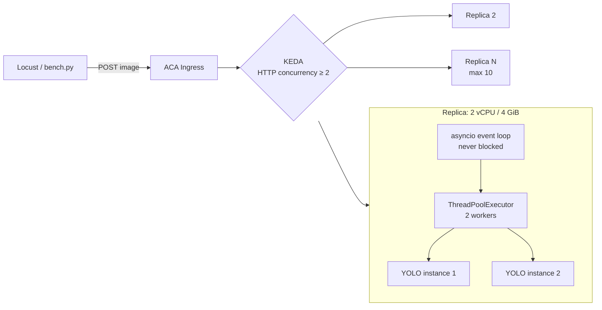

# AI Models on Azure Container Apps — Scaling & Load-Test Demo

Two self-contained demos that wrap an **OSS model in FastAPI**, containerize it, deploy to
**Azure Container Apps (ACA)**, and drive it with a load test to showcase **autoscaling**.

| Demo | Task | Model (OSS) | Endpoint |
|------|------|-------------|----------|
| [`yolo-demo/`](yolo-demo/) | Object detection | Ultralytics **YOLO** (`yolov8n`) | `POST /predict` |
| [`ocr-demo/`](ocr-demo/)   | OCR (read text)  | **EasyOCR** | `POST /ocr` |

Both apps expose the same operational surface so the demo story is identical:

| Route | Purpose |
|-------|---------|
| `GET /` | Service info + effective concurrency config |
| `GET /healthz` | Liveness/readiness probe (used by ACA) |
| `GET /stats` | Live in-flight / peak-concurrency counters — **use this to prove parallelism** |
| `POST /predict` or `/ocr` | Inference (`multipart/form-data`, field `file`) |

> **Note:** YOLO does *object detection* (boxes around objects). EasyOCR does *OCR* (reads text).
> For a scaling/load-test demo the task doesn't matter — pick whichever your team lands on, or demo both.

---

## The concurrency problem (the most valuable part of this demo)

> *"We saw YOLO handle only 1 image at a time — it couldn't run several inferences in parallel."*

This is a real and extremely common failure. It is **not** a limitation of YOLO itself —
it's caused by two independent bugs that almost every naive FastAPI wrapper has. Both are
fixed in this repo, and both are worth showing on screen.

### Cause 1 — Blocking the asyncio event loop

The naive wrapper looks like this, and it is what most teams write first:

```python
@app.post("/predict")
async def predict(file: UploadFile = File(...)):
    ...
    results = model.predict(image)   # <-- blocking, CPU-bound, ~100 ms
    return results
```

`async def` runs the handler **on the event loop thread**. `model.predict()` is a blocking
C/C++ call that never yields. While it runs, the single event loop thread cannot accept a new
connection, parse a request, or answer anything else — **not even `/healthz`**.

Result: the process serves **exactly one request at a time**, regardless of how many CPU cores
the container has. Throughput is pinned at `1 / latency`, and health probes time out under
load, which can make ACA restart otherwise-healthy replicas.

**Fix:** never run blocking inference inside `async def`. Offload it to a thread pool so the
event loop stays free.

```python
loop = asyncio.get_running_loop()
result = await loop.run_in_executor(state["executor"], _infer, image)
```

> FastAPI does this automatically if you declare the handler as plain `def` instead of
> `async def` — but then you get FastAPI's shared 40-thread pool, which runs straight into
> Cause 2. An explicit, bounded executor is the correct fix.

### Cause 2 — Ultralytics `YOLO` objects are not thread-safe

Even after unblocking the event loop, you cannot simply let N threads call the *same* model:

```python
model = YOLO("yolov8n.pt")   # ONE shared instance

def _infer(image):
    return model.predict(image)   # <-- data race across threads
```

A `YOLO` instance lazily creates and **reuses a `model.predictor`** object that holds mutable
per-call state (the current batch, source, and results buffers). Two threads entering
`predict()` concurrently overwrite each other's buffers — you get corrupted or
cross-contaminated detections, and intermittent crashes. The same applies to `easyocr.Reader`.

**Fix:** give every worker thread its **own model instance**, borrowed from a pool:

```python
pool = queue.Queue()
for _ in range(INFERENCE_WORKERS):
    pool.put(YOLO(MODEL_NAME))          # one instance per worker

def _infer(image):
    model = pool.get()                  # borrow — never shared
    try:
        return model.predict(image, verbose=False)
    finally:
        pool.put(model)                 # always return it
```

Because the executor has exactly `INFERENCE_WORKERS` threads and the pool holds exactly
`INFERENCE_WORKERS` models, `pool.get()` never blocks — every running thread is guaranteed
its own model.

### Cause 3 (the subtle one) — CPU oversubscription

PyTorch is already internally multi-threaded: one `predict()` call will by default spread its
matrix maths across *every* core it can see. If you then run 4 workers on a 2-core container,
you get 4 × N threads fighting for 2 cores — context-switch thrashing makes **every** request
slower while total throughput barely moves.

**Fix:** cap intra-op threads per worker and keep `workers × threads ≤ container vCPU`.

```python
torch.set_num_threads(TORCH_THREADS_PER_WORKER)   # default 1
```

> **Gotcha:** `os.cpu_count()` inside a container reports the **host's** core count, not the
> ACA CPU limit. Never auto-size your pool from it — [deploy/deploy.ps1](deploy/deploy.ps1)
> passes `INFERENCE_WORKERS` explicitly as an env var.

### Before / after

| | Naive wrapper | This repo |
|---|---|---|
| Handler | `async def` + blocking call | `async def` + `run_in_executor` |
| Model instances | 1, shared | `INFERENCE_WORKERS`, pooled |
| Torch threads | unbounded (host core count) | `TORCH_THREADS_PER_WORKER` (1) |
| Parallel inferences / replica | **1** | **`INFERENCE_WORKERS`** |
| `/healthz` under load | times out | always answers |
| Correctness under load | races, mixed-up results | isolated per thread |

### Proving it during the demo

`/stats` reports the server's own view of concurrency. Two distinct counters, and the
difference between them *is* the lesson:

| Field | Meaning |
|---|---|
| `in_flight` / `peak_in_flight` | Requests accepted — **queued OR executing** |
| `running` / `peak_running` | Requests actually inside `model.predict()` — **true parallelism** |

`peak_running` can never exceed the pool size, which makes the fix undeniable. **These are real
responses from the deployed app**, same load in both cases (concurrency 8, 40 requests, 1 replica):

```jsonc
// INFERENCE_WORKERS=1 -> 8 requests accepted, but only ever ONE executing
{ "inference_workers": 1, "peak_in_flight": 8, "peak_running": 1, "total_requests": 41 }

// INFERENCE_WORKERS=2 -> same queue depth, TWO executing in parallel
{ "inference_workers": 2, "peak_in_flight": 8, "peak_running": 2, "total_requests": 41 }
```

A large gap between `peak_in_flight` and `peak_running` means requests are **queueing** — the
replica is saturated and ACA should scale out.

Each inference response also carries a breakdown so you can show *where* time goes:

```jsonc
{
  "inference_ms": 154.9,   // real model time
  "total_ms":     155.6,   // as seen by the client
  "queue_wait_ms": 0.7,    // time waiting for a free worker -> the signal to scale out
  "replica": "yolo-demo--vq19mkk-6b97947c6d-fg5hk"
}
```

**`queue_wait_ms` is the money metric.** When it rises while `inference_ms` stays flat, the
replica is saturated and it is time for ACA to add another one.

### Is the output actually correct now?

Yes — and this is the half of the bug that matters most. The naive version doesn't crash, it
**silently returns wrong results**: image A's detections come back for image B. Nothing appears
in the logs; you only find out in production.

The pool makes that structurally impossible:

```python
model = pool.get()          # this thread now OWNS this instance
try:
    return model.predict(image, verbose=False)
finally:
    pool.put(model)         # returned only after the call completes
```

The executor has exactly N threads and the pool holds exactly N models, so **no two threads can
ever hold the same instance**. Isolation is guaranteed by construction, not by timing luck. The
`finally` guarantees an instance is never lost from the pool even if inference raises.

---

## Does this apply to other OSS models?

Almost always yes. The two failure modes generalise, but the *reason* differs per library:

| Model / library | Blocking event loop? | Instance thread-safe? | Recommended parallelism |
|---|---|---|---|
| **Ultralytics YOLO** | Yes — always offload | **No** — reuses `model.predictor` state | Pool of `YOLO` instances |
| **EasyOCR** | Yes | **No** — `Reader` holds per-call state | Pool of `Reader` instances |
| **PaddleOCR** | Yes | **No** — `PaddleOCR` object is stateful | Pool of `PaddleOCR` instances |
| **Tesseract** (`pytesseract`) | Yes | Effectively yes — forks a subprocess per call | Thread pool, no model pool needed |
| **docTR** | Yes | Predictor is stateful | Pool of predictors |
| **Raw `torch.nn.Module`** | Yes | **Yes** for pure `forward()` under `no_grad()` | Share one model, just cap threads |
| **ONNX Runtime** | Yes | **Yes** — `InferenceSession.run()` is thread-safe | Share one session; tune `intra_op_num_threads` |

The rules of thumb:

1. **Every** CPU-bound inference call must be moved off the asyncio event loop. This is universal —
   it has nothing to do with the model, only with how FastAPI/asyncio works.
2. **High-level convenience wrappers are usually NOT thread-safe.** Anything that hides a
   "predictor"/"session"/"pipeline" object and mutates it per call (YOLO, EasyOCR, PaddleOCR,
   HuggingFace `pipeline`) needs one instance per worker.
3. **Low-level inference engines usually ARE thread-safe.** A bare PyTorch `forward()` under
   `torch.no_grad()`, or an ONNX Runtime session, can be shared — there you scale by tuning
   intra-op threads instead of duplicating the model.
4. **When in doubt, pool it.** The cost is memory (`N × model size`); the benefit is correctness.
   `yolov8n` is ~6 MB, so a pool of 2–4 is free. A 2 GB LLM is a different conversation — there
   you share the model and scale out with replicas instead.

Porting either demo to another model means changing only two things: the factory call inside
`lifespan` that fills the pool, and the body of `_infer`. The executor, counters, pooling and
ACA wiring stay identical.

> **Special case — GPU models.** Pooling does *not* help on a single GPU: the device serialises
> kernels anyway and N model copies just consume N× VRAM. There, use batching (collect requests
> for a few ms, run one batched forward) or a purpose-built server such as Triton / vLLM, and
> scale out with GPU-enabled ACA workload profiles.

---

## Two ways to scale — and why we do both

| Axis | Mechanism | Good for | Limit |
|------|-----------|----------|-------|
| **Scale up** (in-replica) | model pool, `INFERENCE_WORKERS` | using the CPU you already pay for | bounded by replica vCPU |
| **Scale out** (replicas) | ACA + KEDA HTTP concurrency rule | unbounded throughput, resilience | cold-start latency |

### Aligning the pool with the ACA scale rule

The two axes must agree, or one of them silently wins. The rule is simply:

$$\text{scale-rule concurrency} = \texttt{INFERENCE\_WORKERS}$$

which is why [deploy/deploy.ps1](deploy/deploy.ps1) defaults `-ConcurrentRequests` to
`-InferenceWorkers`.

| Configuration | What happens |
|---|---|
| Rule **>** workers (rule 10, workers 2) | Replica accepts 10 concurrent but runs 2. The other 8 pile into `queue_wait_ms`; latency balloons and **ACA never scales out** because the replica looks like it's coping. |
| Rule **<** workers (rule 1, workers 2) | ACA adds replicas while each existing one is only half busy. You pay for idle CPU. |
| Rule **=** workers | A replica takes exactly what it can genuinely run in parallel; the moment it would queue, KEDA adds a replica. |

Total capacity:

$$\text{max concurrent inferences} = \texttt{INFERENCE\_WORKERS} \times \text{maxReplicas}$$

With the defaults (2 workers × 10 replicas) the app tops out at **20 concurrent inferences**.

### The "one replica per inference" option

Doing *only* scale-out with `INFERENCE_WORKERS=1` is a legitimate design and the simplest
possible mental model — it sidesteps in-process threading entirely:

```powershell
./deploy.ps1 -Demo yolo -InferenceWorkers 1 -Cpu 1.0 -Memory 2.0Gi -ConcurrentRequests 1
```

Trade-off: scaling becomes purely horizontal, so you pay more cold starts and reload the model
in every replica. The 2-workers-per-replica default gets roughly double the throughput out of
CPU you are already paying for.

---

## Performance & scaling numbers

**All numbers below are real**, measured with [loadtest/bench.py](loadtest/bench.py) against
`yolo-demo` on ACA in `swedencentral`, `yolov8n` @ 640px, 640×480 JPEG input, replicas sized
**2 vCPU / 4 GiB**. Client ran from a laptop over the public internet, so latency includes
real network round-trip.

### A. Per-replica: `INFERENCE_WORKERS` 1 vs 2 (pinned to exactly 1 replica)

| Concurrency | RPS (1 worker) | RPS (2 workers) | p50 1w | p50 2w | p95 1w | p95 2w |
|---:|---:|---:|---:|---:|---:|---:|
| 1 | 5.05 | 4.93 | 197 ms | 202 ms | 215 ms | 221 ms |
| 2 | 6.43 | **7.25** | 303 ms | 258 ms | 341 ms | 291 ms |
| 4 | 6.13 | **7.58** | 619 ms | 514 ms | 1003 ms | 777 ms |
| 8 | 6.71 | **7.69** | 1173 ms | 1004 ms | 1667 ms | 1511 ms |

Reading this:

- **At concurrency 1 they are identical** (~5 RPS, ~150 ms inference) — as expected, one request
  can't benefit from a second worker.
- **The 1-worker curve is flat from concurrency 2 onward** (6.4 → 6.7 RPS). It has hit
  $1/\text{latency}$; everything else just queues, so p50 grows linearly: 303 → 619 → 1173 ms.
  This is exactly the "handles one image at a time" symptom.
- **2 workers lifts the ceiling to ~7.7 RPS (+15%)** and cuts p95 at every level.

> **Honest finding — don't oversell in-replica parallelism.** Going 1→2 workers gave **+15%**,
> not +100%. Measured `inference_ms` rose from ~150 ms to ~250 ms once both workers were busy:
> the two workers *do* run truly in parallel, but they compete for the same hard 2 vCPU quota,
> so each becomes ~1.6× slower. Inference here is **CPU-bound**, and no amount of threading
> creates CPU that isn't there. The fix removes the *architectural* 1-at-a-time limit and the
> correctness bug — but **horizontal scale-out is the axis that actually multiplies throughput.**

### B. Cluster: autoscaling 0 → 10 replicas (concurrency 16, 300 requests per pass)

Three identical back-to-back passes while KEDA scaled out:

| Pass | Replicas serving | RPS | p50 | p95 | max |
|---|---:|---:|---:|---:|---:|
| 1 (burst hits cold app) | **1** | 7.14 | 2184 ms | 2800 ms | 4667 ms |
| 2 (scaling in progress) | **7** | 30.89 | 282 ms | 1631 ms | 1818 ms |
| 3 (fully scaled) | **8** | **44.90** | 297 ms | **530 ms** | 1905 ms |

- **6.3× throughput** (7.14 → 44.90 RPS) purely from replicas.
- **p95 improved 5.3×** (2800 → 530 ms) *while serving 6× more traffic*.
- Scaling is close to linear: 8 replicas × ~5.6 RPS ≈ 45 RPS.

This is the core message of the demo: **scale out, don't just scale up.**

### C. Cold start / scale-from-zero

The first pass above is the cost of `min-replicas 0`: a burst arriving at a cold app is served
by one replica for roughly the first 40 seconds while new replicas pull the image and load
models. Mitigations used here: weights are **baked into the image** (no network fetch at
startup) and every pooled instance is **warmed during `lifespan`**, so a replica only reports
healthy once it can actually serve.

| Situation | Observed |
|---|---|
| Warm replica, health probe | ~44 ms |
| Warm replica, single inference | ~155 ms end-to-end (~153 ms inference) |
| Burst onto cold app | ~40 s at 1-replica throughput before scale-out lands |

Part of that lag is KEDA's own cadence — the deployed scale config is:

```jsonc
{ "minReplicas": 0, "maxReplicas": 10,
  "pollingInterval": 30,   // seconds between scale evaluations
  "cooldownPeriod": 300,   // seconds of quiet before scaling back down
  "rules": [{ "name": "http-concurrency", "http": { "metadata": { "concurrentRequests": "2" } } }] }
```

So a burst can wait up to ~30 s just for the next evaluation, plus replica start-up. The
300 s cooldown is why the app doesn't immediately drop back to zero after a load test — worth
mentioning during the demo so the replica count "staying high" isn't mistaken for a bug.

For a latency-sensitive demo, deploy with `-MinReplicas 1` to keep one replica always warm.

### Capacity model

$$\text{max concurrent inferences} = \texttt{INFERENCE\_WORKERS} \times \text{maxReplicas} = 2 \times 10 = 20$$

---

## Repo layout

```
ai-model-on-aca/
├── yolo-demo/          # YOLO object detection, FastAPI-wrapped
│   ├── app/main.py     #   <- model pool + event-loop offload
│   ├── requirements.txt
│   └── Dockerfile
├── ocr-demo/           # EasyOCR, FastAPI-wrapped (same pattern)
│   ├── app/main.py
│   ├── requirements.txt
│   └── Dockerfile
├── loadtest/
│   ├── bench.py        # concurrency sweep -> the tables above
│   ├── locustfile.py   # sustained load -> triggers ACA autoscale
│   └── requirements.txt
└── deploy/
    ├── deploy.ps1      # ACR build + ACA app with KEDA HTTP scale rule
    └── cleanup.ps1
```

---

## 1. Run locally (Docker)

```powershell
cd yolo-demo
docker build -t yolo-demo:local .
docker run --rm -p 8000:8000 -e INFERENCE_WORKERS=2 yolo-demo:local
```

```powershell
curl http://localhost:8000/healthz
curl http://localhost:8000/stats
curl -X POST http://localhost:8000/predict -F "file=@../sample.jpg"
```

Interactive API docs: http://localhost:8000/docs

### Tuning knobs (env vars)

| Variable | Default | Meaning |
|---|---|---|
| `INFERENCE_WORKERS` | `2` (set by deploy script) | Parallel inferences per replica = model-pool size |
| `TORCH_THREADS_PER_WORKER` | `1` | Torch intra-op threads per worker |
| `YOLO_MODEL` | `yolov8n.pt` | Swap for `yolov8s/m/l` to show the accuracy↔latency trade-off |
| `YOLO_IMGSZ` | `640` | Lower it (e.g. `416`) for a big, visible latency win |
| `OCR_LANGS` | `en` | Comma-separated EasyOCR languages |

---

## 2. Deploy to Azure Container Apps

Builds the image in ACR (no local Docker needed) and creates an ACA app with a
**KEDA HTTP concurrency autoscale rule**.

```powershell
cd deploy
./deploy.ps1 -Demo yolo -ResourceGroup rg-aca-model-demo -Location swedencentral
./deploy.ps1 -Demo ocr  -ResourceGroup rg-aca-model-demo -Location swedencentral
```

Useful switches: `-SkipBuild`, `-MinReplicas`, `-MaxReplicas`, `-InferenceWorkers`,
`-ConcurrentRequests`, `-Cpu`, `-Memory`.

> **Note on PowerShell 5.1:** if `./deploy.ps1` is blocked, run
> `Set-ExecutionPolicy -Scope Process -ExecutionPolicy Bypass -Force` first.
> Region capacity varies — if environment creation fails with `AKSCapacityHeavyUsage`,
> rerun with a different `-Location` and `-SkipBuild`.

---

## 3. Measure

```powershell
cd loadtest
pip install -r requirements.txt

# Concurrency sweep -> fills the per-replica table
python bench.py --host https://<fqdn> --endpoint /predict --levels 1,2,4,8,16

# Sustained load -> triggers autoscale
locust -f locustfile.py --host https://<fqdn> --endpoint /predict `
       --headless -u 100 -r 10 -t 3m
```

Watch it scale:

```powershell
az containerapp replica list -n yolo-demo -g rg-aca-model-demo -o table
```

### Suggested demo narrative

1. **Scale to zero** — show 0 replicas, send one request, show the cold start.
2. **Single replica, rising concurrency** — run `bench.py`; point at `queue_wait_ms` growing
   while `inference_ms` stays flat. *This is saturation.*
3. **The bug** — set `INFERENCE_WORKERS=1` and rerun: `peak_running` never exceeds 1. Explain
   the event loop + thread-safety causes.
4. **The fix** — set `INFERENCE_WORKERS=2`: `peak_running` hits 2 under identical load.
5. **The honest caveat** — throughput only rose ~15%, because inference is CPU-bound and the
   replica has a hard 2 vCPU quota. Segue to scale-out.
6. **Scale out** — drive concurrency 16; watch replica count climb 1 → 8 and RPS go
   7 → 45 while p95 *drops* from 2800 ms to 530 ms.
7. **Scale back in** — stop the load; mention the 300 s cooldown before it returns to zero.

### Live demo cheat-sheet

```powershell
$app = "https://<your-fqdn>"

# server-side concurrency view
Invoke-RestMethod "$app/stats" | ConvertTo-Json -Compress

# flip parallelism live (creates a new revision, ~1 min to roll)
az containerapp update -n yolo-demo -g rg-aca-model-demo --set-env-vars INFERENCE_WORKERS=1
az containerapp update -n yolo-demo -g rg-aca-model-demo --set-env-vars INFERENCE_WORKERS=2

# confirm which config is actually serving before you benchmark
1..5 | ForEach-Object { (Invoke-RestMethod "$app/").inference_workers }

# replica count under load
(az containerapp replica list -n yolo-demo -g rg-aca-model-demo -o json | ConvertFrom-Json).Count
```

> Changing an env var creates a **new revision**; traffic shifts only once it is healthy.
> Always confirm `inference_workers` from `/` before trusting a benchmark run.

---

## Architecture



---

## Cleanup

```powershell
cd deploy
./cleanup.ps1 -ResourceGroup rg-aca-model-demo
```
